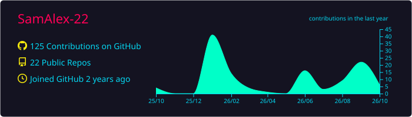
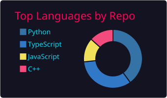
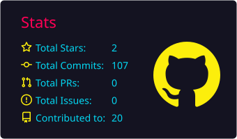
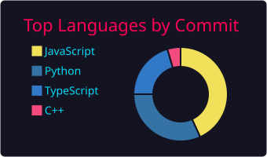
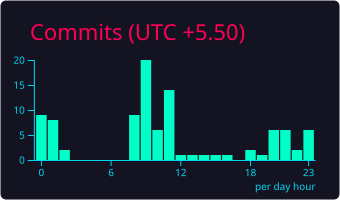

<!-- ╔══════════════════════════════════════════════════════════════════╗ -->
<!-- ║  Samuel Alexander — GitHub Profile README                       ║ -->
<!-- ║  Theme: Hacker Terminal · Colors: #FF6600 #00FF41 #FF073A       ║ -->
<!-- ╚══════════════════════════════════════════════════════════════════╝ -->

<h1 align="center">
  
</h1>

<p align="center">
  
  
  
</p>

<p align="center">
  <a href="https://linkedin.com/in/samuel-alexander-v-2b25712a5"></a>
  <a href="mailto:alexanderhere2005@gmail.com"></a>
  <a href="https://medium.com/@alexanderhere2005"></a>
  <a href="https://github.com/SamAlex-22?tab=followers"></a>
</p>

---

### `[root@SamAlex-22]# cat /etc/profile.d/identity.yaml`

```yaml
name: Samuel Alexander (Alex)
role: Cyber Security Engineer | Penetration Tester | AI Security Researcher
institution: SKCET — Final Year, B.E. CSE (Cyber Security)

focus_areas:
  - Web & Mobile Application Penetration Testing
  - Active Directory Exploitation
  - Cloud Security (AWS / Azure)
  - AI-Powered Offensive Security
  - Threat Detection & Response

currently_building:
  - Gemini Red   → Containerized autonomous pentesting agent
  - OneSense     → On-device AI deepfake & synthetic threat shield

community:
  - Volunteer Ambassador @ Hack for a Change
  - OWASP & DefCon Coimbatore — Active Member

ranking: TryHackMe — Top 3% globally
methodology: Break → Analyze → Rebuild → Secure → Repeat
```

---

### `nmap -sV --script=vuln skillset.local`

<table align="center">
<tr>
<td valign="top" width="50%">

**🕸️ Offensive Security**


</td>
<td valign="top" width="50%">

**🛠️ Languages & Frameworks**


</td>
</tr>
<tr>
<td valign="top" width="50%">

**☁️ Cloud & Infrastructure**


</td>
<td valign="top" width="50%">

**🔧 Security Toolkit**


</td>
</tr>
</table>

---

### `ls -la ~/arsenal/projects/`

<table>
<tr>
<td width="50%" valign="top">

<h3 align="center">🛡️ Project ODIN</h3>
<p align="center">
  <a href="https://github.com/SamAlex-22/Project-ODIN">
    
  </a>
</p>
<p align="center"><strong>One-way Detection & Inference Network</strong></p>
<p align="center">Layer 5 per-threat inference modules with unidirectional diode constraint for advanced network security monitoring</p>
<p align="center">
  
  
  
</p>

</td>
<td width="50%" valign="top">

<h3 align="center">⛓️ Active Chain Directory</h3>
<p align="center">
  <a href="https://github.com/SamAlex-22/active-chain-directory">
    
  </a>
</p>
<p align="center"><strong>Web3 Active Directory</strong></p>
<p align="center">Decentralized identity & asset management system bridging traditional AD concepts with blockchain technology</p>
<p align="center">
  
  
  
</p>

</td>
</tr>
<tr>
<td width="50%" valign="top">

<h3 align="center">🎨 QuoteCard AI</h3>
<p align="center">
  <a href="https://github.com/SamAlex-22/QuoteCard-AI">
    
  </a>
</p>
<p align="center"><strong>AI-Powered Quote Image Generator</strong></p>
<p align="center">Generative AI tool that transforms text quotes into styled visual cards — designed for content creators & video makers</p>
<p align="center">
  
  
  
</p>

</td>
<td width="50%" valign="top">

<h3 align="center">🏍️ Crash Detection IoT</h3>
<p align="center">
  <a href="https://github.com/SamAlex-22/Bike-Crash-Detection-System---IOT">
    
  </a>
</p>
<p align="center"><strong>Vehicle Crash Detection System</strong></p>
<p align="center">IoT-based crash detection using tilt & accelerometer sensors with real-time GPS location tracking & emergency alerts</p>
<p align="center">
  
  
  
</p>

</td>
</tr>
<tr>
<td colspan="2" align="center">

<br>

**🚧 Coming Soon**

🔴 **Gemini Red** — Containerized autonomous pentesting agent &nbsp;&nbsp;·&nbsp;&nbsp; 🛡️ **OneSense** — On-device synthetic reality shield

<br>

</td>
</tr>
</table>

<p align="center">
  <a href="https://github.com/SamAlex-22?tab=repositories">
    
  </a>
</p>

---

### `./metrics.sh --mode=dashboard`

<p align="center">
  
</p>

<!-- ═══ Profile Summary Cards (auto-generated by GitHub Actions) ═══ -->
<!-- Run the "Profile Summary Cards" workflow to populate these images -->

<p align="center">
  
</p>

<p align="center">
  
  
</p>

<p align="center">
  
  
</p>

---

### `cat /var/log/contributions.log`

<!-- ═══ Contribution Snake (auto-generated by GitHub Actions) ═══ -->
<!-- Run the "Generate Snake" workflow to populate this animation -->

<p align="center">
  <picture>
    <source media="(prefers-color-scheme: dark)" srcset="https://raw.githubusercontent.com/SamAlex-22/SamAlex-22/output/github-snake-dark.svg" />
    <source media="(prefers-color-scheme: light)" srcset="https://raw.githubusercontent.com/SamAlex-22/SamAlex-22/output/github-snake.svg" />
    
  </picture>
</p>

---

### `cat /var/log/achievements.log`

<table align="center">
<tr>
<td valign="top" width="50%">

**📜 Certifications**
- 🏅 Certified Penetration Testing Professional (CPENT) — EC-Council
- 🏅 Certified Ethical Hacker (CEH) — Cisco
- 🏅 AI For App Building — Google
- 🏅 Version Control — Meta
- 🏅 Google Cloud Computing Foundations — Google

</td>
<td valign="top" width="50%">

**🏆 Recognition**
- 🥇 TryHackMe — Top 3% globally
- 🤝 Volunteer Ambassador — Hack for a Change
- 🛡️ Active member — OWASP Chapter
- 💀 Active member — DefCon Coimbatore

</td>
</tr>
</table>

---

### `git log --oneline --graph --all career.timeline`

```
* 2026 ─── Final year, B.E. CSE (Cyber Security) @ SKCET
│         ├── Building Gemini Red & OneSense
│         └── Targeting OSCP certification
│
* 2025 ─── Started Gemini Red & OneSense development
│         ├── Volunteering with Hack for a Change
│         └── Deep-diving into AI-powered offensive security
│
* 2024 ─── Joined OWASP & DefCon Coimbatore
│         ├── Active on TryHackMe — reached Top 3%
│         └── First CTF competitions
│
* 2023 ─── Began formal cybersecurity coursework
          └── Foundation in networking & system administration
```

---

### `curl -s api.collaborate.me`

<p align="center">
  Interested in <strong>offensive security research</strong>, <strong>AI-security tooling</strong>, or <strong>CTF collaborations</strong>?<br>
  Let's connect and build something that makes the internet safer.
</p>

<p align="center">
  <a href="https://github.com/SamAlex-22?tab=repositories"></a>
  &nbsp;
  <a href="https://linkedin.com/in/samuel-alexander-v-2b25712a5"></a>
  &nbsp;
  <a href="mailto:alexanderhere2005@gmail.com"></a>
</p>

---

<p align="center">
  
</p>

<p align="center">
  <em>"The quieter you become, the more you are able to hear."</em><br>
  <sub>— Kali Linux motto</sub>
</p>
